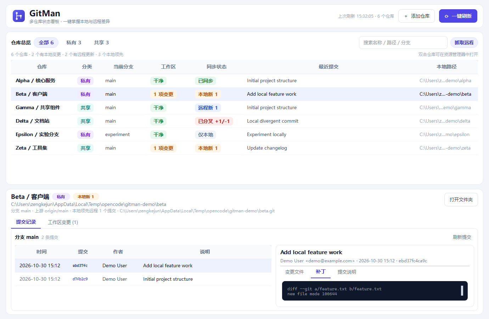
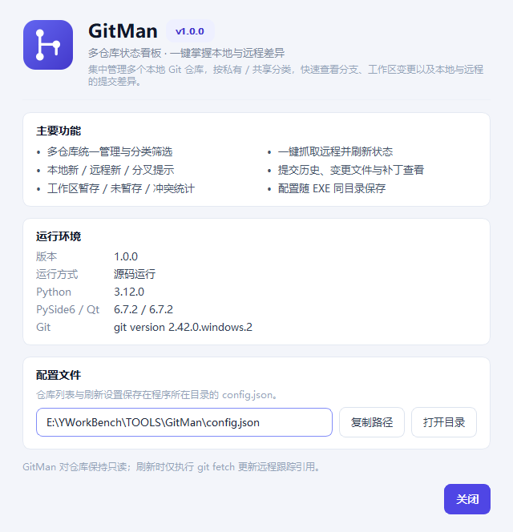

# GitMan · 多仓库状态看板

GitMan 是一个使用 **Python + PySide6** 编写的 Windows 桌面工具，用于集中管理多个本地 Git 仓库。填写本地仓库文件夹地址即可关联仓库，按 **私有 / 共享** 分类，一键刷新后查看分支、工作区变更，以及本地与远程提交的领先 / 落后关系。



## 功能

- **多仓库管理**：按本地文件夹路径添加仓库，自动识别 Git 根目录，支持名称和分类编辑、右键移除。
- **私有 / 共享分类**：顶部筛选按钮可快速切换，支持名称、路径、分支搜索。
- **一键刷新**：F5 或点击“一键刷新”，并发读取所有仓库状态，不阻塞界面。
- **工作区状态**：显示已暂存、未暂存、未跟踪和冲突文件，并提供“工作区变更”明细页。
- **本地 / 远程对比**：
  - `本地新 N`：本地有 N 个提交尚未推送到远程；
  - `远程新 N`：远程有 N 个提交尚未拉取到本地；
  - `已分叉 +N/-M`：本地和远程都有新提交；
  - `已同步`、`仅本地`、`分离 HEAD`、`无法比较` 等状态。
- **Commit 查看**：点击仓库查看当前分支最近 200 条提交，选择提交后查看：
  - 作者、时间、完整提交说明；
  - 变更文件列表；
  - 带语法高亮的完整补丁。
- **关于页面**：查看版本、运行环境、Git 版本、配置文件位置，并可直接打开配置目录或复制路径。
- **本地持久化**：仓库列表与“刷新时抓取远程”设置保存在 EXE（源码运行时为项目根目录）同级的 `config.json` 中。

## 环境要求

- Windows 10 / 11
- Python 3.10+
- Git 2.30+（已加入 `PATH`）
- PySide6 6.6+

当前版本已在 Python 3.12、PySide6 6.7.2、Git 2.42 上测试。

## 安装与启动

```powershell
cd E:\YWorkBench\TOOLS\GitMan
python -m venv .venv
.\.venv\Scripts\Activate.ps1
python -m pip install -r requirements.txt
python main.py
```

也可以直接双击 `run.bat`（需已安装 Python 与依赖）。

指定其他配置文件：

```powershell
python main.py --config D:\Data\gitman-config.json
```

## 使用说明

1. 点击右上角 **添加仓库**，填写或选择本地 Git 仓库文件夹。
2. GitMan 会自动定位仓库根目录，可填写显示名称并选择 **私有 / 共享**。
3. 点击 **一键刷新**：
   - 默认先对每个仓库执行 `git fetch --all --prune`；
   - 然后读取当前分支、上游分支、工作区状态和最近提交；
   - 所有仓库并行扫描，完成一个显示一个。
4. 点击列表中的仓库，在下方查看提交记录、变更文件和补丁；切换到“工作区变更”查看未提交文件。
5. 右键仓库可打开文件夹、复制路径、编辑名称 / 分类或从列表移除。
6. 点击右上角 **关于** 或按 `F1` 查看版本、运行环境与配置文件位置。

### 快捷键

| 快捷键 | 作用 |
| --- | --- |
| `F5` | 一键刷新 |
| `Ctrl+N` | 添加仓库 |
| `Ctrl+F` | 聚焦搜索框 |
| `F1` | 打开关于页面 |

## 状态说明

### 同步状态

| 显示 | 含义 |
| --- | --- |
| `已同步` | 本地 HEAD 与上游分支一致 |
| `本地新 N` | 本地领先远程 N 个提交（需要推送） |
| `远程新 N` | 远程领先本地 N 个提交（需要拉取） |
| `已分叉 +N/-M` | 本地领先 N 个提交，同时远程领先 M 个提交 |
| `仅本地` | 当前分支没有可比较的远程分支 |
| `分离 HEAD` | 当前不在任何分支上 |
| `无法比较` | 仓库没有提交，或无法读取比较结果 |

> 如果本地分支未设置上游，GitMan 会尝试与同名远程分支（优先 `origin`）比较，并在提示中注明“未设置上游”。

### 工作区状态

| 显示 | 含义 |
| --- | --- |
| `干净` | 没有未提交变更 |
| `N 项变更` | 有暂存 / 未暂存 / 未跟踪文件 |
| `冲突 N` | 存在合并冲突 |
| `不可用` | 路径不存在、不是 Git 仓库或读取失败 |

远程状态依赖 `git fetch`。如果网络或凭据不可用，仓库仍会显示本地状态，并在同步状态提示中标注“远程抓取失败”，此时远程领先 / 落后数量可能过期。

## 安全说明

GitMan 对仓库是**只读**的，不会执行 `commit`、`pull`、`push`、`reset` 等修改操作。唯一的写操作是刷新时执行 `git fetch` 更新远程跟踪引用；可在界面右上角关闭“抓取远程”。

- 刷新使用 `GIT_TERMINAL_PROMPT=0`，避免命令阻塞等待输入；抓取失败会在状态提示中显示。
- 捕获到的远程 URL 会隐藏其中的用户名 / 密码信息。
- 从列表移除仓库不会删除本地文件。

## 配置文件

默认位置为**程序所在目录**：

```text
<GitMan.exe 所在目录>\config.json
```

从源码运行时，配置文件位于项目根目录：

```text
E:\YWorkBench\TOOLS\GitMan\config.json
```

因此把 EXE 和 `config.json` 放在同一个文件夹即可移动或备份整个程序。配置使用 JSON 保存，写入时采用临时文件原子替换。

- 程序所在目录需要有写入权限；不建议放在 `C:\Program Files` 等只读目录。
- 也可以通过环境变量 `GITMAN_CONFIG` 或命令行 `--config` 指定其他路径。

## 关于页面

点击右上角 **关于** 或按 `F1` 打开。页面会显示应用版本、运行方式、Python / PySide6 / Qt / Git 版本，以及当前配置文件位置，并支持复制路径和打开配置目录。



## 项目结构

```text
GitMan/
├─ main.py                    # 应用入口
├─ run.bat                    # Windows 启动脚本
├─ build_exe.ps1              # PyInstaller 构建脚本
├─ build_exe.bat              # 双击构建的批处理入口
├─ requirements.txt
├─ requirements-dev.txt       # 构建依赖
├─ version_info.txt           # EXE 版本信息
├─ assets/
│  └─ gitman.ico              # 应用图标（多尺寸 ICO）
├─ gitman/
│  ├─ config.py               # 配置读写
│  ├─ git_service.py          # Git 命令封装、状态与提交读取
│  ├─ models.py               # 数据模型
│  ├─ workers.py              # 后台线程任务
│  └─ ui/
│     ├─ main_window.py       # 主窗口
│     ├─ dialogs.py           # 添加 / 编辑仓库对话框
│     ├─ about_dialog.py      # 关于页面
│     ├─ repo_model.py        # 仓库表格模型与搜索过滤
│     ├─ delegates.py         # 状态徽章绘制
│     ├─ formatting.py        # 状态文案与配色
│     ├─ syntax.py            # 补丁语法高亮
│     └─ theme.py             # 主题与图标
└─ tests/                     # Git 服务与配置单元测试
```

## 运行测试

```powershell
python -m unittest discover -s tests -v
```

测试会在临时目录创建本地裸仓库和克隆，覆盖：

- 干净仓库、本地领先、远程领先、分叉；
- 工作区变更统计；
- 提交列表与提交详情；
- 子目录定位仓库根目录；
- 配置读写、损坏配置与重复仓库过滤。

## 编译为 EXE

构建脚本使用 **PyInstaller**，会自动使用 `.venv\Scripts\python.exe`（如果存在），否则使用 PATH 中的 `python`。缺少 PySide6 或 PyInstaller 时会自动安装。

### 一键构建单文件 EXE

双击 `build_exe.bat`，或在 PowerShell 中执行：

```powershell
.\build_exe.ps1
```

生成：

```text
dist\GitMan.exe
```

单文件版分发最方便，但首次启动时需要先解压运行库，启动会稍慢。

配置文件将生成在 EXE 同级：

```text
dist\config.json
```

### 构建文件夹版

```powershell
.\build_exe.ps1 -Mode onedir
```

生成：

```text
dist\GitMan\GitMan.exe
```

文件夹版启动更快，但分发时必须保留 `dist\GitMan\` 内的全部文件。配置文件位于：

```text
dist\GitMan\config.json
```

### 脚本参数

| 参数 | 说明 |
| --- | --- |
| `-Mode onefile` | 单文件 EXE（默认） |
| `-Mode onedir` | 文件夹版 |
| `-NoInstall` | 缺少构建依赖时不自动安装，直接报错 |
| `-KeepBuild` | 保留 `build\` 中间文件，便于排查构建问题 |

也可以手动安装构建依赖：

```powershell
python -m pip install -r requirements-dev.txt
```

构建时自动使用：

- `assets\gitman.ico` 作为 EXE 图标；
- `version_info.txt` 写入文件版本、产品名称等 Windows 属性。

> 单文件 PyInstaller 程序首次启动会被解压到临时目录，部分杀毒软件可能误报。如果更在意启动速度或稳定性，建议使用文件夹版。
